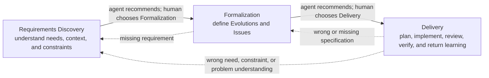

# Praxis

Praxis is a human-steered system for turning uncertainty into shared
understanding, shared understanding into bounded authority, and bounded
authority into small, reviewable working results.

This tracked directory is the maintained design source for Praxis 1.0. It is
not a runtime plugin. The separate source under `.agents/plugins/praxis/` is the
self-contained Praxis runtime candidate; this directory remains the authority
for design meaning while the candidate is reconciled for release.

Read [Status](STATUS.md) before changing this directory or implementing from
it.

## The system in one view

Praxis is not one mandatory workflow. It is a network of small recursive loops
with three primary owners:



The three owners are a responsibility projection over four functional loops:

- Requirements Discovery owns **Understanding**.
- Formalization owns **Proposal**.
- Delivery owns **Execution** and **Result/Learning**.

Clear work may skip any owner whose question is already answered. The agent
recommends a proportionate path in ordinary language; it does not force every
request through Praxis terminology or ceremony. Later evidence returns to the
earliest owner whose governing truth changed.

## Design ownership

The design has five kinds of material. Their locations say who owns current
meaning; the accepted target package sections separately decide its runtime
projection.

| Design material | Current owner | Runtime consequence |
| --- | --- | --- |
| `core/*.md` | Cross-skill Praxis meaning | Every skill applies the relevant consequences locally; no hidden kernel is assumed. |
| `skills/<skill>/README.md` | One skill's accepted behavioral and target package design | Determines the separately authored `SPEC.md`, `SKILL.md`, host metadata, and accepted resources. |
| `skills/<skill>/references/` | Semantic material associated with one skill | Source for the exact inline, local-reference, shared-reference, or omitted projection named by the owning target package. |
| `references/` | Cross-skill semantic material and accepted shared-reference architecture | Owns the six shared runtime targets and direct-consumer agreement; records local projection and capability reclassification decisions. |
| `evidence/` and `history/` | Research and provenance | May explain or challenge current truth; never overrides maintained design by itself. |

### Core meaning is not a runtime reference

[Premise](core/premise.md), [System](core/system.md), [Work](core/work.md),
[Control](core/control.md), and [Context](core/context.md) own global Praxis
meaning. An executing skill does not depend on loading those documents.

Instead, each skill's design applies the relevant global rule to its own
entry, authority, procedure, return, and stopping behavior. Its future
`SKILL.md` carries the instruction the agent needs on that path; its `SPEC.md`
records how the local contract conforms to the global meaning. This small
local projection is required runtime behavior, not a second owner for the
global concept.

Here, **global** means canonical semantic ownership, not automatic placement in
one global runtime file. Runtime instruction lives at its point of use. When
several skills each need the same short rule on their normal path, each
`SKILL.md` may carry the necessary local projection. Shared runtime references
exist for substantial conditional knowledge that passes the shared-admission
test, not merely to remove repeated prose.

### Skill design is not a runtime skill

Each `skills/<skill>/README.md` is a human-readable behavioral design. It may
contain rationale, examples, source links, and semantic material that should
not enter normal model context. It must not be renamed, copied, or lightly
reformatted into `SKILL.md`.

Use [Writing Great Skills](../skills/writing-great-skills/SKILL.md) and its
[Glossary](../skills/writing-great-skills/GLOSSARY.md) for every agent-readable
runtime surface, not only the `SKILL.md` body. The normative
[agent-readable runtime projection](skills/README.md#agent-readable-runtime-projection)
distinguishes descriptions, host prompts, executable skill bodies, and loaded
references and requires each to be distilled for its own job.

**SKILL-CREATOR IS PROHIBITED. DO NOT READ, INVOKE, CITE, FOLLOW, OR USE IT FOR
PRAXIS DESIGN, IMPLEMENTATION, REVIEW, OR VALIDATION.**

The [skill design index](skills/README.md) owns the package-design gate,
runtime surface roles, direct composition rules, and implementation boundary.

### Current references are semantic source material

Files currently stored under a skill's `references/` directory preserve
accepted semantic meaning for that skill. The top-level [cross-skill material
index](references/README.md) preserves cross-package meaning and owns its
accepted shared runtime projection.

Those locations are for design navigation. A current filename, split,
directory, status banner, or link does not by itself approve an equivalent
runtime reference. The `## Target runtime package` section in each skill design
now decides whether each meaning belongs in `SKILL.md`, a renamed or reshaped
local reference, an accepted shared reference, another owned capability, or no
runtime material at all. Implementation follows that map; it does not
reinterpret the source tree.

This authoring use of “reference” is distinct from the capital-R
**References** in [Context](core/context.md), which are Project context that
preserves an external or existing source and its relevance.

## Reading path

Use the smallest relevant path:

1. Read [Premise](core/premise.md) for the purpose and commitments.
2. Read [System](core/system.md) for ownership and composition.
3. Read [Work](core/work.md) for work forms and route choice.
4. Read [Control](core/control.md) for entry, authority, learning, and stopping.
5. Read [Context](core/context.md) for persistence and progressive loading.
6. Use the [skill index](skills/README.md) to select one package.
7. Read that package's `README.md` and only the semantic material needed to
   understand its current branch or design question.

Do not read every package, the complete [decision
history](history/decisions.md), or the full [scenario
corpus](history/scenarios.md) as routine context.

## Human control

[Control](core/control.md#bounded-autonomy-workflow-entry-and-authority) owns
the canonical relationship among navigation, behavioral entry, approval,
effect authority, acceptance, and stopping.

- The agent recommends one proportionate next move.
- The human chooses forward work and negotiable governing meaning.
- A recommendation is not invocation, approval, or effect authority.
- Plan Approval does not authorize implementation.
- An implementation instruction covers only its named boundary.
- Pair begins only through a direct human request.
- Orient begins after a human request or acceptance of a bounded suggestion.
- Every bounded result returns with evidence, limitations, and learning.
- Acceptance stops; adjacent work does not begin by momentum.

These meanings remain global. Every skill design states their concrete local
consequences instead of making the runtime agent reconstruct them from this
summary.

## What belongs here

Praxis design contains:

- a compact current system model;
- one behavioral design package for each eventual skill;
- semantic material associated with those packages;
- cross-skill semantic material and its accepted runtime projection;
- evidence that shaped the design; and
- cold history for provenance and contradiction recovery.

It does not contain:

- a candidate runtime plugin;
- copied or prewritten `SKILL.md` files;
- implementation Plans, receipts, or batch roadmaps;
- executable evaluation machinery;
- a global kernel, router, wrapper, or Praxis CLI; or
- placeholder runtime packages and resources.

## Design-to-runtime boundary

Three states must remain visible:

1. **Semantic source** preserves current meaning and evidence.
2. **Accepted target package design** decides the runtime information
   hierarchy, files, direct dependencies, invocation, and conformance boundary
   for one skill.
3. **Implemented and verified runtime package** realizes that accepted design
   in executable model context and maintainer surfaces, with its accepted
   checks passing.

Existing semantic source does not skip the target-package decision. Discussion
or acceptance of a package design does not authorize implementation.

### Fixed runtime foundations

The following foundations are currently accepted:

- the runtime source remains `.agents/plugins/praxis/`;
- the existing plugin manifest, marketplace identity, license, and logo are
  preserved by the runtime candidate;
- there is no plugin-root skill, global runtime kernel, wrapper, or Praxis CLI;
- each implemented skill is independently discoverable and carries a
  co-located maintainer specification;
- skills compose through direct bounded calls while callers retain ownership;
  and
- implementation proceeds one reviewed package or prerequisite at a time.

The exact skill package contract is maintained in
[skills/README.md](skills/README.md). The plugin runtime source is the single
source for current identity metadata; this design does not duplicate its JSON.

### Self-contained plugin documentation

The plugin documentation surface is part of the runtime source, not a later
release embellishment. The assembled candidate carries these documents so
every co-located `SPEC.md` can name durable owners inside the distributed
plugin instead of depending on this design workspace.

The accepted plugin source tree includes:

```text
.agents/plugins/praxis/
|-- LICENSE
|-- README.md
|-- CHANGELOG.md
|-- docs/
|   |-- guide/
|   |   |-- getting-started.md
|   |   |-- working-with-praxis.md
|   |   `-- examples.md
|   |-- reference/
|   |   |-- capabilities.md
|   |   `-- integrations.md
|   |-- concepts/
|   |   |-- premise.md
|   |   |-- system.md
|   |   |-- control.md
|   |   |-- context.md
|   |   `-- work.md
|   `-- maintainers/
|       |-- skill-packages.md
|       `-- conformance-and-release.md
|-- references/
|   |-- evaluation.md
|   |-- learning-return.md
|   `-- records/
|       |-- foundations.md
|       |-- discovery.md
|       |-- formalization.md
|       `-- delivery.md
|-- assets/
|   `-- praxis.png
|-- .codex-plugin/
|   `-- plugin.json
`-- skills/
    `-- <skill-name>/
        |-- SKILL.md
        |-- SPEC.md
        `-- agents/openai.yaml
```

The root `README.md` is the concise public landing page: what Praxis is and is
not, its current availability, one ordinary-language starting path, its central
human-agent promise, and links to deeper owners. It does not duplicate the
capability catalog, Setup procedure, system model, or complete control
contract. `CHANGELOG.md` records public version and compatibility changes, not
implementation activity.

`docs/guide/` is public task and collaboration guidance:

- `getting-started.md` owns the shortest truthful path from availability and
  explicit repository Setup when needed to the first real ordinary-language
  request;
- `working-with-praxis.md` owns observable daily collaboration: recommendation,
  human choice, effect authority, redirection, resumption, bounded evidence
  return, and stopping; and
- `examples.md` owns a small curated contrast among Direct Work, bounded
  Delivery, Evolve, explicitly requested Pair, and suggested or declined
  Orient without becoming executable tests or golden transcripts.

`docs/reference/` is public lookup material. `capabilities.md` is a
non-lifecycle catalog that states what each capability helps accomplish, how
its behavior may begin, and what bounded result it returns; internal calls and
dependency contracts remain in `SPEC.md`. `integrations.md` documents only
verified support, versions, readiness, installation or update paths, ownership,
and limits. Its initial scope is Praxis host availability, required
Plannotator, and optional Docker for a selected Security audit.

`docs/concepts/` is the durable maintained owner of cross-skill Praxis meaning:

- `premise.md` owns the thesis and durable commitments;
- `system.md` owns recursive owning loops, bounded skill composition, causal
  return, and the placement of gates, Pair, and Orient;
- `control.md` owns behavioral entry, human choice, approval, effect authority,
  acceptance, continuation or return, revision, assurance, reconstruction, and
  stopping;
- `context.md` owns conversational versus durable context, records, artifacts,
  References, messages, lifetimes, promotion, continuity, progressive loading,
  and reconstruction; and
- `work.md` owns Direct Work and the proportional meanings and relationships of
  Initiatives, Projects, Evolutions, Issues, Plans, results, and route changes.

Each concept document is the complete maintained successor to its corresponding
`core/` semantic owner, not a summary or runtime instruction. It preserves all
durable meaning while removing design status, provenance, historical argument,
and temporary implementation notes. Concept cross-links resolve to another
plugin-local concept, a skill `SPEC.md`, or an exact runtime reference—never
back into `praxis-design/`.

`docs/maintainers/skill-packages.md` owns the self-contained authoring contract
for one Praxis package: `SKILL.md` and `SPEC.md` roles and reconciliation,
invocation and host metadata, Writing Great Skills principles required by every
agent-readable surface, conditional references, optional resources, direct
dependencies, links, and package conformance. It carries the all-caps
SKILL-CREATOR prohibition. `docs/maintainers/conformance-and-release.md` owns
whole-plugin assembly, cross-package and cross-document consistency,
forward-testing, manifests and adapters, integrations, versioning, changelog,
and release gates without creating a permanent evaluation framework or Praxis
validator CLI.

Every `SPEC.md` is self-contained within the plugin source tree. Its source
basis links the relevant `docs/concepts/` owners, the package-authoring
contract, sibling skill specifications, and exact runtime references it uses.
It never names `.agents/praxis-design/`, repository-only authoring skills, cold
history, or other source that will not ship with the plugin. Design and history
remain provenance used to author and audit the distributed contract, not a
runtime dependency.

Public and maintained docs are not normal executing-model context. `SKILL.md`
remains self-sufficient and loads only accepted runtime references. The docs do
not reproduce complete skill procedures or runtime reference contracts;
plugin-level `references/` remains selectively loaded agent knowledge rather
than public documentation or a workflow owner.

### Design and runtime status

All 28 current skills have accepted target package designs. Their invocation,
information hierarchy, reference architecture, optional resources, local
application of global rules, gaps, and conformance boundaries are recorded in
their owning `README.md` files under the normative [package-design
gate](skills/README.md#package-design-gate). The assembled runtime follows
those decisions; future corrections must not leave package choices to an
implementation worker.

The public, concept, and maintainer documentation architecture above is
assembled in the runtime candidate. All 28 skill packages and the six shared
runtime references retain their separately accepted target designs. Final
whole-plugin conformance and the human release decision remain tracked in
[STATUS](STATUS.md).

## Maintenance discipline

Design corrections proceed in small reviewed slices:

1. identify the current owner and all relevant semantic sources;
2. preserve unique accepted meaning;
3. distinguish cleanup from a new design decision;
4. rewrite current authority rather than adding another layer;
5. check neighboring links, ownership claims, and contradictions;
6. show the exact uncommitted diff; and
7. stop for human review before committing or beginning another slice.

Do not shorten material merely to reduce line count. Remove duplication and
obsolete implementation direction while preserving explanation, examples,
evidence, and behavioral boundaries that still change judgment.
