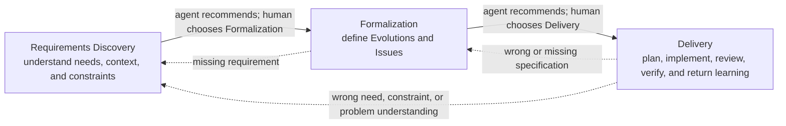

# Praxis

Praxis is a human-steered system for turning uncertainty into shared
understanding, shared understanding into bounded authority, and bounded
authority into small, reviewable working results.

This tracked directory is the maintained design source for Praxis 1.0. It is
not a runtime plugin. Installed and cached historical Praxis copies were
removed. The separate runtime source under `.agents/plugins/praxis/` begins as
a minimal skeleton and must be inspected rather than recreated or treated as
authoritative.

See [Status](STATUS.md) before changing this directory or implementing anything
from it.

The documents under `skills/` are **design packages for future skills**, not
runtime skills written in advance. Their `README.md` files preserve accepted
behavior, boundaries, rationale, examples, and candidate packaging. They must
not be renamed, copied, or lightly reformatted into `SKILL.md`.

Implementation uses each package as source material and writes a real runtime
skill. Use [Writing Great Skills](../skills/writing-great-skills/SKILL.md) and
its [Glossary](../skills/writing-great-skills/GLOSSARY.md) as the sole
skill-authoring method: choose invocation metadata for the intended reach and
context load, keep branch-common behavior visible, disclose branch-specific
knowledge through direct context pointers, co-locate related rules, make
completion criteria checkable and exhaustive where needed, and prune
duplication, sediment, and no-ops against observed behavior. Preserve the
accepted meaning, not the design document's prose or structure.

## The system in one view

Praxis is not one mandatory workflow. It is a network of small recursive loops
with three primary owners:



The three owners are a navigation and responsibility projection over four
functional loops:

- Requirements Discovery owns **Understanding**.
- Formalization owns **Proposal**.
- Delivery owns **Execution** and **Result/Learning**.

The four-loop view explains how work behaves; the three-owner view explains
where its current question and return belong. Result/Learning remains a real
loop inside Delivery even though it is not a fourth global owner. Neither view
replaces the other.

Each owner works its own question locally. Later evidence can return to the
exact earlier owner that introduced a mistaken assumption. The corrected truth
then moves forward only through work whose meaning or authority changed.

Clear work may skip any owner whose question is already answered. The agent
recommends a proportionate path in ordinary language; it does not force every
request through Praxis terminology or ceremony.

## Reading path

Use the smallest relevant path:

1. Read [Premise](core/premise.md) for the purpose and design commitments.
2. Read [System](core/system.md) for recursion and owner relationships.
3. Read [Work and Routes](core/work.md) when deciding how Projects,
   Evolutions, Issues, Plans, and Direct Work relate.
4. Read [Control](core/control.md) for human judgment, authority, learning,
   backtracking, and stopping.
5. Read [Context](core/context.md) for persistence, ownership, records,
   artifacts, references, envelopes, and progressive loading.
6. Use the [skill index](skills/README.md) to select one relevant package.
7. Read that skill's `README.md`, then load only the local or
   [shared reference](references/README.md) its current path needs.

Do not read every skill package, the complete [decision
history](history/decisions.md), or the full [scenario
corpus](history/scenarios.md) as routine context. Evidence and history exist for
rationale, contradiction recovery, and deeper review—not normal execution.

## Context types

Praxis keeps four kinds of context distinct:

- **Records** preserve governing meaning such as Requirements, Evolutions,
  Issues, and Implementation Plans.
- **Artifacts** make something perceptible or judgeable, such as prototypes,
  diagrams, explainers, comparisons, images, or experiments.
- **References** preserve an external or existing source together with what it
  demonstrates and why it matters.
- **Envelopes** are native messages carrying the compact truth, evidence,
  question, result, or authority-source pointer another owner needs.

These are not interchangeable. An artifact does not become a specification
because it was persuasive, and a message does not transfer authority.

## Human control

Agent navigation, workflow entry, human judgment, approval, and authority are
different controls. [Control](core/control.md#bounded-autonomy-workflow-entry-and-authority)
defines their canonical relationship.

- The agent proactively navigates, recommends one useful next move, and
  performs internal and automatic supporting work inside current bounds.
- The human is not expected to remember the process or skill names.
- Human-owned gates and forward owner or route choices remain human judgments;
  the agent recommends them before waiting.
- Explicitly invoked workflows begin only after a clear human request, even
  when the agent has recommended one.
- Pair is a human-initiated implementation posture that the agent neither
  infers nor recommends.
- Orient is a human-selected supporting capability: the agent may recommend a
  bounded orientation, but teaching begins only after the human agrees.
- A recommendation is not an invocation, approval, or grant of authority.
- The human collaborates on every negotiable governing record.
- Plannotator approval accepts only the exact revision and meaning presented.
- Approval does not silently begin the next activity.
- Plan Approval does not authorize implementation.
- A later explicit implementation instruction authorizes only that Plan and
  does not cover unnamed consequential effects.
- Every bounded result returns to the human with evidence, limitations,
  learning, and a recommendation.
- Acceptance stops. Adjacent work never begins automatically.

## What belongs here

Praxis should contain:

- a compact current system model;
- one self-contained design package for each eventual skill;
- genuinely shared references;
- the evidence that shaped the model; and
- cold decision and scenario history for contradiction recovery.

It should not contain:

- a candidate runtime plugin;
- implementation Plans or receipts;
- executable evaluation machinery;
- a global kernel, router, wrapper, or Praxis CLI;
- generated migration tools; or
- duplicated contracts that force an agent to reconstruct current truth.

## Implementation boundary

### Canonical runtime plugin root

The final runtime plugin is named `praxis` and uses this structure:

```text
.agents/plugins/praxis/
|-- LICENSE
|-- README.md
|-- docs/
|   |-- guide/
|   |   |-- getting-started.md
|   |   |-- working-with-praxis.md
|   |   `-- examples.md
|   |-- reference/
|   |   |-- capabilities.md
|   |   `-- integrations.md
|   |-- concepts/
|   |   |-- premise.md
|   |   |-- system.md
|   |   |-- control.md
|   |   |-- context.md
|   |   `-- work.md
|   `-- maintainers/
|       |-- skill-packages.md
|       `-- conformance-and-release.md
|-- references/
|   |-- feedback-and-evaluation.md
|   |-- learning-and-return.md
|   |-- worktree-isolation-and-preservation.md
|   `-- records/
|       |-- README.md
|       |-- core.md
|       |-- discovery.md
|       |-- formalization.md
|       `-- delivery.md
|-- assets/
|   `-- praxis.png
|-- .codex-plugin/
|   `-- plugin.json
`-- skills/
    `-- <skill-name>/
        |-- SKILL.md
        |-- SPEC.md
        `-- agents/openai.yaml
```

`.codex-plugin/plugin.json` is the required plugin manifest. `skills/` contains
the independently discoverable Praxis packages. There is no plugin-root
`SKILL.md`, behavioral specification, router, kernel, wrapper, or Praxis CLI.

The plugin-root `README.md` is the public documentation entry point. It
states what Praxis is and is not, its central human-agent collaboration promise,
current installation and readiness status, one ordinary-language starting
example, and the most important authority and stopping guarantees. It links to
the guides, public references, maintained concepts, and maintainer
documentation. It does not duplicate the capability catalog, complete control
vocabulary, Setup procedure, or system architecture. Add installation or
availability instructions only when they become current.

`docs/guide/` and `docs/reference/` are public user documentation.
`docs/guide/getting-started.md` owns the shortest truthful path from making
Praxis available to beginning the first real request: explicitly request
repository Setup when readiness is needed, verify Plannotator without creating
placeholder Praxis state, describe the actual work in ordinary language, and
understand that the agent recommends a proportionate path while effect
authority remains separate. It does not explain the full capability catalog,
system model, or every workflow. `docs/guide/working-with-praxis.md` owns the
day-to-day collaboration model after getting started: what the agent
proactively recommends, when it may proceed, when it waits for a human choice,
how effect authority is requested, how the human redirects or resumes work, and
how bounded results return with evidence and stop. It explains observable
behavior through small examples without teaching internal loop architecture or
enumerating every capability. `docs/guide/examples.md` provides a small curated
set of realistic human-agent conversations and outcomes that contrast Direct
Work, bounded Delivery, Evolve, explicitly requested Pair, and suggested or
declined Orient. They show how Praxis feels without becoming golden
transcripts, executable tests, process scripts, or exhaustive skill coverage.
`docs/reference/capabilities.md` is the public non-lifecycle capability
reference. For each capability it answers what the capability helps accomplish,
how its behavior may begin, and what bounded result it returns. It is organized
by owned responsibility and entry behavior and distinguishes agent-startable
capabilities, suggested paths that require acceptance, explicitly invoked
workflows, and human-initiated postures. Internal composition and dependency
contracts remain in skill specifications. Its Make Tangible entry describes
the user-visible judged artifact, version, fidelity limits, reaction, and
return without reproducing the artifact procedure. `docs/reference/integrations.md`
documents only integrations Praxis actually supports and has verified. Each
entry states the capability enabled, whether it is required or optional, who
may recommend, configure, and use it, supported hosts or versions, installation
and update paths, and operational and authority limits. Initially it covers
Praxis host availability, required Plannotator, and optional Docker for selected
Security audits—not a general tool catalog or speculative compatibility list.

`docs/concepts/` is maintained system documentation. `premise.md`, `system.md`,
`control.md`, `context.md`, and `work.md` preserve the durable cross-skill
meaning currently owned by the corresponding accepted `core/` documents.
Together they own the philosophy and proportional structure; owning loops and
composition; bounded autonomy, entry, authority, approval, acceptance, and
stopping; persistence and progressive context; and the work forms and routes.
Each concept document becomes the complete maintained successor to its
corresponding core design document. It preserves all durable cross-skill meaning
while removing design-workspace status, historical argument, and implementation
notes that do not belong in the final plugin. Concept documents are neither
lightweight summaries nor runtime instruction files, and they do not present
Praxis as a mandatory lifecycle.

#### Concept-document projection

Translate every retained cross-link to its final owner while creating a
concept document:

- another concept uses a local concept link such as `control.md`;
- maintained skill behavior links to `../../skills/<skill>/SPEC.md`;
- an exact shared runtime procedure or schema links to
  `../../references/<path>.md`;
- an exact skill-local procedure links to
  `../../skills/<skill>/references/<file>.md`.

No final concept document links into `praxis-design/`, `core/`, or a temporary
skill `README.md`. It does not use `SKILL.md` as maintained documentation;
`SKILL.md` remains the executable runtime projection of the behavior documented
by `SPEC.md`.

`docs/concepts/premise.md` owns why Praxis exists and the commitments every
capability must preserve: lights-on collaboration, unknown-driven learning,
proportional structure, changeability under known pressure, human judgment,
bounded agent autonomy, and deliberate stopping. It may retain a concise set of
direct intellectual sources that genuinely explain those commitments, but not
the research ledger or design history. Exact entry rules, gates, records, and
work structures belong to their other concept owners.

`docs/concepts/system.md` owns the composition model: Requirements Discovery,
Formalization, and Delivery as recursive owning loops rather than lifecycle
phases; supporting capability calls and returns that do not transfer ownership;
learning returned to the earliest causal owner; the system placement of gates,
Pair, and Orient; and representative routes that prescribe no universal
sequence. It makes supporting ownership concrete: a caller retains its question
and interpretation while Make Tangible owns artifact construction and lifetime.
Exact authority semantics belong to `control.md`, persistence to
`context.md`, and Project, Evolution, Issue, and Plan structure to `work.md`.

`docs/concepts/control.md` is the normative cross-system control contract. It
owns the human-agent responsibility split; the separation of recommendation,
behavioral entry, approval, effect authority, acceptance, and stopping; entry
classes and internal versus human-selected forward transitions; and universal
continue-or-return, revision, bounded execution, gates, assurance, stopping,
and reconstruction rules. It also owns the cross-system Pair and Orient
boundaries, including that Orient cannot become Requirements Discovery or
Formalization. Skill `SPEC.md` files apply these rules locally without
redefining them; capability procedures and record structures remain with their
other owners.

`docs/concepts/context.md` owns the conceptual persistence and reconstruction
model: when work remains conversational and when durable context is justified;
context ownership and placement; the distinctions among records, artifacts,
references, envelopes, messages, and reconstructible source evidence;
promotion; the distinct lifecycles of records, artifacts, References, and
messages or temporary checkpoints; active Delivery continuity; and progressive
loading and reconstruction. It explains meaning and relationships rather than
mirroring runtime procedures. Exact record lifecycle and schemas belong to
runtime `references/records/`; exact artifact handling belongs to Make
Tangible's skill-local
`skills/make-tangible/references/artifact-lifetime.md`.

`docs/concepts/work.md` owns the proportional work-form model: when no
implementation structure is useful; Direct Work; the meanings and relationships
of Initiatives, Projects, Evolutions, Issues, and Implementation Plans; when
each form becomes useful or durable; standalone and nested forms; results,
completion, and evidence-driven route changes. It explicitly rejects lifecycle
stage mapping and mandatory nesting. Exact gate behavior remains in
`control.md`; exact record bodies and paths remain in runtime
`references/records/`.

`docs/maintainers/skill-packages.md` owns the authoring contract for one Praxis
skill package: canonical directory shape; `SKILL.md` and `SPEC.md` roles and
reconciliation; required frontmatter and `agents/openai.yaml`; skill-local
references and optional resources; direct skill and shared-reference dependency
declarations; and package-level validation expectations. It does not document
individual skill behavior or the plugin-wide release process.
`docs/maintainers/conformance-and-release.md` owns the whole-plugin path from an
implemented package to a releasable Praxis version: implementation and review
sequence; per-skill structural and behavioral conformance; cross-skill and
cross-document consistency; forward-testing of subtle entry, authority, and
stopping behavior; plugin manifest, versioning, marketplace, host adapters,
integrations, and release gates; and changelog requirements. Validation remains
lightweight and reproducible; Praxis gains no permanent evaluation framework,
validator CLI, or generated receipt system. Add a root
`CHANGELOG.md` with the first public release and record user-visible behavior
and compatibility changes, not implementation history. Add `CONTRIBUTING.md`,
`SECURITY.md`, migration guides, or further documentation only when a concrete
public need exists.

Each skill's co-located `SPEC.md` remains the documentation and maintainer
authority for that skill's complete behavioral contract. The maintained concept
documents own cross-skill meaning that no individual skill owns. A
contradiction between these surfaces invalidates the plugin; reconcile both
against accepted human judgment rather than allowing either to silently
override the other. Skill packages contain no README.

README and `docs/` are not runtime model context. Runtime skills remain
self-sufficient for the instructions they need and do not depend on an agent
loading `docs/`. Public and maintained documentation does not duplicate complete
skill procedures or runtime reference contracts. It contains no design history,
decision ledger, implementation diary, or temporary migration guidance.

Plugin-level `references/` contains shared runtime contracts and schemas loaded
selectively by declared direct consumers. It is not public documentation and
never becomes a workflow owner. Skill-local references remain inside their
owning package. The plugin root has no `references/README.md`. Each consuming
`SKILL.md` links the exact shared file with a path such as
`../../references/<file>.md` at the decision point, states the load condition,
and declares the dependency in its `SPEC.md`. Keep
`references/records/README.md` only as the record-family selector for consumers
that do not yet know the record kind; a consumer that knows the kind links the
exact schema file or heading directly. Every plugin-level shared reference is
operationally self-contained when loaded with its consuming `SKILL.md`. It may
link another reference for optional depth, but it cannot require a hidden
reference chain or any file under `docs/`. When two shared contracts are both
required for a decision, the consuming `SKILL.md` links and declares both
directly. Plugin-level references use the same quality contract as skill-local
references: plain Markdown, lowercase kebab-case filenames, no frontmatter or
universal heading template, inspectable scope, governing guidance, limits, and
failure cases, and a table of contents when length impedes navigation. Split a
reference only when different load conditions justify separate context. A
plugin-level reference additionally requires multiple direct skill consumers.
Keep the tree shallow: the three cross-skill contracts live directly under
`references/`, and `records/` is the only initial nested directory because it
is one coherent schema family with a real selection problem. Do not add generic
`contracts/`, `guides/`, `common/`, or `shared/` groupings. Another nested
family requires several related files and a genuine runtime selection need.

Do not initially create plugin-level `hooks/`, `scripts/`, `.mcp.json`, or
`.app.json`. The established Praxis logo at `assets/praxis.png` is the sole
initial plugin-level asset. Plannotator remains a required external CLI used
through its owning skill; it does not create an MCP or app component. Add
another optional plugin component only after one concrete accepted capability
requires it. Marketplace registration lives outside the plugin root.

The initial `.codex-plugin/plugin.json` uses this shape:

```json
{
  "name": "praxis",
  "version": "0.1.0",
  "description": "Human-steered software engineering through shared understanding, bounded authority, and reviewable results.",
  "author": {
    "name": "Abdullah Elsayed"
  },
  "license": "MIT",
  "skills": "./skills/",
  "interface": {
    "displayName": "Praxis",
    "shortDescription": "Human-steered software engineering",
    "longDescription": "Turn uncertainty into shared understanding, bound implementation authority explicitly, and deliver small reviewable working results.",
    "developerName": "Abdullah Elsayed",
    "category": "Developer Tools",
    "capabilities": [
      "Interactive",
      "Write"
    ],
    "defaultPrompt": [
      "Help me choose the smallest useful path for this work."
    ],
    "composerIcon": "./assets/praxis.png",
    "logo": "./assets/praxis.png"
  }
}
```

The partial runtime begins at `0.1.0`. Publish `1.0.0` only when the accepted
Praxis 1.0 design has been implemented and validated. `author.name` and
`interface.developerName` both use the accepted publisher identity `Abdullah
Elsayed`. Runtime manifests never contain placeholders.

The capability labels describe host-visible interaction rather than mutation
authority. The starter prompt is an ordinary-language entry point and neither
preselects a hidden workflow nor authorizes effects. The accepted Praxis image
is both composer icon and logo. Omit `homepage`, `repository`, `keywords`,
additional branding, screenshots, apps, MCP servers, and hooks until their
exact metadata or capability is separately accepted.

The plugin ships the canonical MIT license text in `LICENSE` with `Copyright
(c) 2026 Abdullah Elsayed`. The manifest declares `"license": "MIT"`.

### Marketplace registration

The repository-local marketplace remains outside the plugin root:

```text
.agents/
`-- plugins/
    |-- marketplace.json
    `-- praxis/
```

Do not create or mutate a personal `~/.agents/plugins/marketplace.json` for this
source. Preserve the existing marketplace identity and entry order, and use
this eventual Praxis entry:

```json
{
  "name": "praxis",
  "source": {
    "source": "local",
    "path": "./plugins/praxis"
  },
  "policy": {
    "installation": "AVAILABLE",
    "authentication": "ON_INSTALL"
  },
  "category": "Developer Tools"
}
```

Omit `policy.products`. `AVAILABLE` means installable rather than installed by
default. `ON_INSTALL` is marketplace authentication timing metadata and grants
Praxis no credentials or operational authority.

Defer marketplace installation and Codex or Pi export until the complete
runtime passes validation. During partial implementation, validate the plugin
directly from `.agents/plugins/praxis/`; marketplace availability is not
behavioral proof.

### Runtime conformance and release

Call one skill package-conformant only after its complete package passes the
first two kinds of judgment below. This is a local status: it does not claim
that every direct callee exists or that the assembled capability is available.
The third judgment belongs to the complete plugin before release.

Use [Writing Great Skills](../skills/writing-great-skills/SKILL.md) and its
[Glossary](../skills/writing-great-skills/GLOSSARY.md) as the sole
skill-authoring and skill-review methodology. They govern predictability,
invocation wording and load, information hierarchy, branch disclosure,
co-location, completion criteria, pruning, no-op testing, and observed
behavior. They do not define Praxis package shape, frontmatter, host schema,
manifest, or release gates. Those mechanical checks are owned by this design:
use the package contract in [the skill index](skills/README.md), the checks
below, and any checked-in Praxis validation script after inspecting its current
implementation. Do not substitute a host-generic authoring guide or
scaffolding defaults for those sources. If a Praxis-owned checker is
unavailable, perform equivalent inspectable checks and report the limitation
instead of silently calling the package validated.

First, validate its structure and contracts:

- `SKILL.md` follows the exact frontmatter and runtime contract in
  [the skill index](skills/README.md);
- `agents/openai.yaml` follows the exact host schema in
  [the skill index](skills/README.md#host-metadata-and-invocation);
- `SPEC.md` documents every accepted observable local contract and applicable
  conformance case without duplicating runtime procedure or design history;
- every material invariant and case is traceable to executable instruction in
  `SKILL.md`;
- frontmatter, host metadata, behavioral entry, authority, direct dependencies,
  results, and stopping agree;
- every linked reference and bundled resource exists with a precise load or use
  condition;
- no placeholder, empty optional directory, obsolete design file, or package
  README remains; and
- each concrete script or asset is exercised through its representative path or
  intended output medium.

An unresolved cross-skill link is permitted only under the [partial-runtime
composition](skills/README.md#partial-runtime-composition) rule: its target
must be an accepted package, the missing assembly dependency must be reported,
and no placeholder is created. Missing skill-local resources or directly
loaded plugin references still fail the package gate.

Second, establish behavioral confidence. Walk every `SPEC.md` behavioral case
against the runtime instructions. Forward-test a skill when routing, authority,
ownership, adaptive procedure, or another subtle behavior could plausibly be
misread. Use fresh context and realistic requests or raw artifacts without
revealing the intended answer or suspected failure. Keep these checks
disposable: do not create a permanent harness, score ledger, receipt, or
executable scenario suite. One passing example never cancels an uncovered
contradiction.

Third, before `1.0.0` and marketplace installation:

- every accepted skill package has passed its package gate;
- the complete plugin passes the Praxis-owned manifest, link, resource, and
  release checks in this design and any applicable checked-in Praxis
  validation script;
- manifest, public README, license, skills, and marketplace metadata agree;
- every relative link and declared asset resolves;
- Plannotator's required commands, result shapes, question transports,
  archive-reading behavior, and Make Tangible visual resources have direct
  accepted contracts and corresponding conformance evidence;
- no temporary implementation or migration artifact remains;
- representative ordinary-language entry, skill composition, human-owned
  boundaries, and stopping work in the assembled plugin;
- Codex or Pi export and installation adapters are validated only after the
  source plugin passes; and
- the complete fixed result receives human review before release.

Validation helpers remain external authoring tools rather than Praxis runtime
components. Do not add a plugin validation framework, CLI, global router, or
executable evaluation system.

Runtime implementation proceeds one meaningful change at a time. The agent
first inspects the partial runtime and recommends either the smallest missing
plugin-wide prerequisite or one complete skill package. The human discusses
that recommendation and authorizes the change conversationally. The agent then
implements directly from the accepted design source, reviews and validates the
exact change, asks before committing, and stops with one recommendation for
what could follow.

A plugin-wide prerequisite is one concrete root, documentation, or shared-
reference component required for structural validity or by the selected
package. A complete skill package includes `SKILL.md`, `SPEC.md`,
`agents/openai.yaml`, and every directly required skill-local resource. If a
directly required plugin-wide reference is missing, include it in the same
discussed implementation slice and validate its contract against every direct
consumer. Implementing one prerequisite does not authorize unrelated
documentation, shared references, package shells, or placeholders.

Do not create an implementation Plan, plan file, receipt, executable eval,
batch roadmap, or placeholder for later skills. A skill may require several
meaningful incremental commits; do not force one monolithic package commit or
begin the next change by momentum.

For each package, first distinguish:

- behavior the runtime agent must follow directly in `SKILL.md`, the runtime
  projection it actually executes;
- the co-located `SPEC.md`, which is the maintainer authority for intended
  behavior and conformance but is not routine runtime context;
- `agents/openai.yaml`, which owns OpenAI-host presentation, invocation policy,
  and declared host or tool dependencies;
- conditional knowledge that earns a runtime `references/` file;
- deterministic or output material that earns `scripts/` or `assets/`; and
- rationale, evidence, history, and implementation notes that belong in plugin
  documentation or remain design provenance rather than runtime context.

The [runtime contract and
projection](skills/README.md#runtime-contract-and-projection) and [host metadata
and invocation](skills/README.md#host-metadata-and-invocation) rules define how
these surfaces remain aligned without collapsing their roles. Behavioral entry
lives in the runtime contract; host launch policy remains an interface choice.
A contradiction inside either contract invalidates the component, and no
surface silently overrides another. The runtime skill should read like a
well-authored skill, not like a design specification addressed to its
implementer.

`praxis-design` is tracked maintained design work. Stage and review design and
runtime paths deliberately so a runtime implementation commit contains exactly
the approved design and implementation boundary plus any other changes the
human explicitly includes.

Installed or cached historical Praxis behavior must not be used as the source
for Praxis 1.0.
