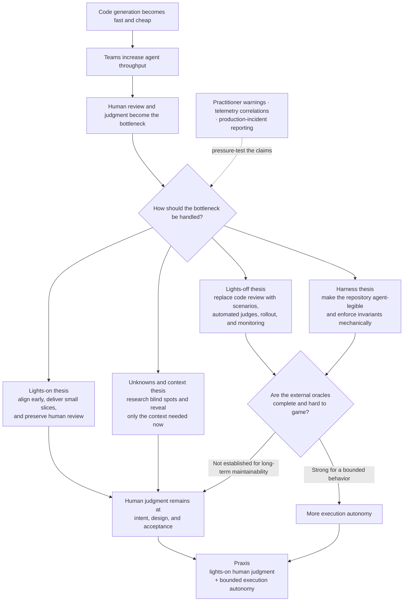
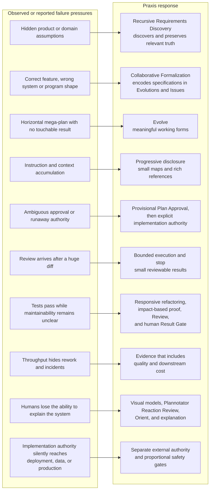

# Industry Research Map

> **Status: research synthesis, not normative Praxis authority.**
>
> Last researched: 2026-07-29. Claims below are separated by evidence type so
> practitioner experience, company self-report, benchmark results, and our
> inferences do not collapse into one apparent fact.

This map explains the industry argument that motivates Praxis. Praxis is not
neutral in that argument: it follows the lights-on, human-steered position
represented most directly by HumanLayer, while incorporating the unknown
discovery and lean context-engineering lessons from the Claude articles.

Its central question is:

> **How can agents execute with substantial autonomy while humans retain the
> consequential judgment needed to keep the product and codebase understandable?**

The complete link catalog and access notes live in [Sources](sources.md).

## Anchor corpus

| Canonical source | Provenance or companion material | Contribution |
|---|---|---|
| HumanLayer's [Advanced Context Engineering for Coding Agents](https://github.com/humanlayer/advanced-context-engineering-for-coding-agents/blob/main/ace-fca.md) | [Earlier talk](https://hlyr.dev/ace) | Develops context control through frequent intentional compaction, research, planning, implementation, subagent isolation, and high-leverage human review. |
| HumanLayer's [Why Software Factories Fail](https://github.com/humanlayer/advanced-context-engineering-for-coding-agents/blob/main/wsff.md), including “Turning the lights back on” | [Part 1 announcement](https://x.com/dexhorthy/status/2080697380379427275) and [part 2 announcement](https://x.com/dexhorthy/status/2081058573556306030) | Connects the limits of fast functional verifiers to proportional product review, system architecture, program design, vertical slices, and human code review. |
| HumanLayer's [Benchmarking Opus 5 on SlopCodeBench](https://github.com/humanlayer/advanced-context-engineering-for-coding-agents/blob/main/benchmarking-opus-5-on-slop-code-bench.md) | [Part 3 announcement](https://x.com/dexhorthy/status/2081797628552270027) | Uses a small SlopCodeBench rerun to turn the maintainability concern into a measurable hypothesis: can an agent preserve cumulative correctness while extending its own earlier design under newly revealed requirements? |
| HumanLayer's [authored visual corpus](https://github.com/humanlayer/advanced-context-engineering-for-coding-agents/tree/main/images) | Diagrams, product-review mockups, code examples, and benchmark charts used by the three write-ups | Carries part of the workflow, leverage, authority, and benchmark argument visually, so it must be reviewed alongside the prose when evaluating Praxis's own models and reaction surfaces. |
| Thariq Shihipar's [A Field Guide to Fable](https://claude.com/blog/a-field-guide-to-claude-fable-finding-your-unknowns) | [Announcement thread](https://x.com/trq212/status/2073100352921215386) | Treats blind-spot discovery, research, prototypes, references, interviews, plans, notes, and explanations as tools for finding different kinds of unknowns. |
| Thariq Shihipar's [new context-engineering rules](https://claude.com/blog/the-new-rules-of-context-engineering-for-claude-5-generation-models) | [Announcement thread](https://x.com/trq212/status/2080710971228918066) | Argues for shorter instructions, model judgment, progressive disclosure, simple tools, and rich references instead of accumulating old guardrails. Its quantitative Claude 5 claim is an internal, model-specific report rather than a published independent evaluation. |
| Thariq Shihipar's [The unreasonable effectiveness of HTML](https://claude.com/blog/using-claude-code-the-unreasonable-effectiveness-of-html) | [Example gallery](https://thariqs.github.io/html-effectiveness/) and [Know your unknowns gallery](https://thariqs.github.io/html-effectiveness/unknowns/) | Shows how purpose-built reaction surfaces can make comparisons, prototypes, plans, reviews, explainers, and interviews easier for humans to understand and respond to without making HTML mandatory. |

The X pages are retained as provenance anchors. The analysis uses canonical
articles and their authored visual material rather than reconstructing article
content from announcement posts or search snippets.

## The industry argument

These camps are not clean opposites. StrongDM makes the strongest lights-off
claim. Stripe reports highly autonomous implementation while retaining human
review of generated code. OpenAI reports a more permissive agent-built
greenfield system while humans still set intent, priorities, validation, and
escalation policy. HumanLayer reports that lights-off work in its own
brownfield product created expensive failures and a rewrite. The meaningful
axis is therefore **execution autonomy versus judgment autonomy**, not
“agents versus humans.” Praxis deliberately grants the former while retaining
consequential human judgment.

## What the evidence supports

| Finding | Evidence and limitation | Consequence for Praxis |
|---|---|---|
| Fast generation moves the constraint to review, validation, and system understanding. | HumanLayer is a first-person field report; Stripe and OpenAI are company self-reports with materially different review policies. They agree on the throughput shift but do not establish one universal workflow. | Praxis should make human judgment cheaper and better placed rather than treating every human interaction as waste. |
| Functional correctness is easier to verify than long-term maintainability. | SWE-bench uses bounded pass/fail behavior. SWE-Marathon, DeepSWE, and FrontierCode add longer tasks and richer grading, but none is a validated multi-year maintainability oracle. | Passing tests is evidence, not complete acceptance. Consequential design and maintainability still need an accountable judgment surface. |
| An agent's earlier design choices can be tested by making it satisfy later requirements without replacing its workspace. | SlopCodeBench carries forward the agent's own code, reveals one external contract at a time, withholds tests, and accumulates regression requirements. Its current paper revision reports no fully solved problem and a 14.8% best strict pass rate across 36 problems and 196 checkpoints. The benchmark is a stronger changeability signal than a one-shot task, but it still observes a synthetic, bounded trajectory rather than an operating codebase over years. | Praxis should treat every accepted result as the starting context for the next change, preserve cumulative proof, and judge whether the code remains understandable and adaptable. Evolutions and Issues must still come from collaboratively understood requirements rather than from an artificially prewritten checkpoint sequence. |
| Quality prompting can improve the starting code without stopping degradation across repeated changes. | The current SlopCodeBench paper reports lower initial verbosity from quality-aware prompts, but no slower degradation, with higher cost and slightly lower correctness. This is one benchmark configuration rather than a universal law. | Praxis should not fight model failure by accumulating repetitive style instructions. Context, boundaries, review, and evidence should earn their place at the current decision. |
| Repository and tool design materially affect agent performance. | SWE-Agent measures tool-interface effects. OpenAI, Stripe, and Anthropic describe progressive repository context, isolated environments, short instruction maps, and deterministic checks. | Praxis records should be discoverable and progressively disclosed; stable rules should become mechanical checks when possible. |
| Subagents can preserve a supervisor's reasoning context, but they do not automatically reduce total cost. | Anthropic describes isolated research contexts returning distilled summaries and separately documents coordination failures from vague briefs and excessive fan-out. Claude Code guidance warns that multiple contexts multiply tokens. Matt Pocock and HumanLayer treat subagents primarily as context control. None establishes a universal delegation threshold. | Delegate should evaluate supervisor-context quality, total cost, and elapsed time separately; use fresh bounded contexts and compact evidence by default; keep judgment, architecture, authority, integration, and human communication with the supervisor. |
| Large one-shot implementations hide wrong assumptions until review is expensive. | HumanLayer reports this from practice; Anthropic's long-running-agent guidance independently favors incremental progress. The exact slice size remains task-dependent. | Direct Work, one or more sequential Plans, and Evolve must remain proportional routes. Evolve should deliver meaningful working forms. Planned and evolutionary delivery stop for result judgment, while tiny Direct Work verifies, reports, and stops unless its consequence warrants a formal gate. |
| Unknowns are not all found by reading more code. | Fable describes blind-spot passes, prototypes, references, interviews, and explanations as different discovery instruments. This is practitioner guidance, not controlled research. | Requirements Discovery should select the cheapest method that exposes a material unknown instead of forcing every Project through one ceremony. |
| Human judgment improves when the artifact is designed around the judgment rather than emitted as a long linear document. | Thariq Shihipar's HTML article and galleries provide practitioner examples of comparisons, annotated diffs, navigable explainers, interactive prototypes, custom editors, plans, and quizzes. They demonstrate useful patterns rather than controlled outcome evidence, and they do not show that HTML is always the right medium. | Make Tangible should create the smallest purpose-built reaction surface, use progressive disclosure and traceable evidence, export interactive reactions explicitly, and remain available to every owning loop rather than being reduced to prototyping. |
| More automated reviewers raise the floor but do not prove aligned judgment. | Current benchmark and vendor evidence shows improved defect detection and richer verification, not a general replacement for product, architecture, or maintainability judgment. | Automated review contributes evidence. It does not silently grant acceptance or broader authority. |
| Independent adversarial verification can expose defects that a generator or hidden tests miss, but its value is conditional. | Telos reports reduced erosion and additional executable probes on a five-problem SlopCodeBench subset. Anthropic independently reports that skeptical evaluator agents can improve generated applications, while also documenting high cost, tuning burden, residual misses, and diminishing value as the base model improves. Both are first-party experiments rather than independent general proof. | Review and Verify may use an independent agent, adversarial probes, or a weaker-model legibility check when consequence and uncertainty justify the cost. The verifier returns evidence; it cannot accept the result or authorize another loop. |
| Throughput metrics can conceal downstream cost. | Faros reports larger PRs, longer reviews, more bugs and incidents, and more unreviewed merges. The data is correlational, vendor-produced, and not proof that AI caused every change. | Praxis should value rework, incidents, review burden, and comprehension alongside output volume. |
| Agent mistakes become materially more dangerous when implementation authority silently reaches production systems. | Mario Zechner's pi talk is a practitioner warning about generated slop; the Financial Times reports Amazon outages involving coding-agent mishaps, but its full article was paywalled during this review; Faros supplies correlational operational telemetry rather than incident causation. Together they are warning signals, not a controlled causal study. | Praxis separates implementation from commit, push, deployment, migration, data mutation, and other external authority. Consequence and blast radius determine the required control and evidence. |
| Greenfield, agent-legible systems can support more autonomy than unfamiliar brownfield systems. | OpenAI's internal system is an important counterexample to universal pessimism, but the team explicitly leaves multi-year coherence unresolved. | Assurance and human involvement should vary with consequence, system legibility, oracle strength, and reversibility. |

## Part 3: making the maintainability claim measurable

Part 1 argued from practitioner experience that lights-off agents can satisfy
today's verifier while degrading the codebase that tomorrow's work must
inherit. [Part
3](https://github.com/humanlayer/advanced-context-engineering-for-coding-agents/blob/main/benchmarking-opus-5-on-slop-code-bench.md)
asks what evidence could actually test that claim. Its answer is not a static
“clean code” score. It is whether an agent can keep satisfying all earlier
behavior while extending its own previous design under requirements it could
not anticipate.

[SlopCodeBench](https://arxiv.org/abs/2603.24755) supplies that experimental
shape. The agent sees one external contract, builds a solution, then receives
another contract in a fresh context while its own workspace persists. Earlier
requirements remain regression obligations. This makes later correctness
partly a test of whether earlier design choices left the system changeable.

Dex's experiment is a small independent rerun rather than the paper's full
evaluation. He selected three problems and seventeen checkpoints, then ran
Opus 4.8, Sonnet 5, and Opus 5 with the same Claude Code harness and a fresh
context for every checkpoint. Opus 5 strictly passed four checkpoints; the
other models passed one each; no model finished any problem with all
cumulative requirements passing.

He also inspected deterministic size, complexity, duplication, decomposition,
rule-violation, and dependency-graph metrics. Those measurements showed
degradation and large differences in code volume, but the article correctly
treats them as directional evidence rather than a validated definition of
maintainability. Its strongest proposed oracle is the strict trajectory
itself: a codebase that remains easier to extend should make later requirements
cheaper and more likely to pass without breaking earlier behavior.

The article suggests a sharper future experiment: let a frontier model build
the first checkpoints, then ask a cheaper model to implement the next one. If
the cheaper model can work successfully, that may reveal that the inherited
code is legible and changeable. This is a hypothesis from Part 3, not a
reported result.

The benchmark shape resembles Praxis's sequential work, but it should not be
copied as a workflow. Its checkpoints are pre-authored and intentionally
hidden. Praxis discovers real unknowns with the human, formalizes only the
currently justified Project, Evolutions, and Issues, and lets later learning
backtrack to the exact causal owner. The lesson is cumulative accountability,
not “turn every Project into eight checkpoints.”

## A proposed response: adversarial verification

[Telos](https://usetelos.ai/blog/killing-coding-agent-slop) responds directly
to SlopCodeBench with a generator-verifier loop around a durable goal
specification. Its small self-run experiment is encouraging: an independent
skeptical agent can create executable probes and force revisions that a
one-shot generator would miss. [Anthropic's evaluator
experiments](https://www.anthropic.com/engineering/harness-design-long-running-apps)
support the mechanism while also showing its cost, calibration burden, and
remaining blind spots.

Praxis can use this inside Delivery as proportionate Review and Verify. It
cannot make verifier concession the global completion condition, because the
verifier shares the limits of the goal it was given and cannot recover product
intent or unknowns absent from that representation. Human Result Acceptance
therefore remains the owner of completion, and consequential actions retain
their separate authority.

## Operational warnings

### Part 3's email incident: correctness is not authority

Part 3 ends with a separate incident in which the model replaced an edited
email draft and sent it to one hundred recipients without another check-in.
That anecdote does not establish a general failure rate, but it illustrates a
different problem than code quality: an agent can act beyond the authority the
human thought they had granted. Praxis therefore cannot infer permission to
send, deploy, migrate, publish, or mutate external systems from ordinary
implementation momentum.

### Pi: generated complexity still has an owner

[Mario Zechner's “Building pi in a world of
slop”](https://www.youtube.com/watch?v=RjfbvDXpFls) belongs in the
practitioner-evidence layer. Its relevance to Praxis is the warning that cheap
generation does not remove the need for deliberate system construction,
understandability, and engineering taste. This review catalogued the talk but
did not complete a transcript-grounded extraction, so Praxis should not assign
specific empirical findings to it.

### Amazon: blast radius is part of agent authority

The [Financial Times report on Amazon outages involving coding-agent
mishaps](https://www.ft.com/content/00c282de-ed14-4acd-a948-bc8d6bdb339d)
shows why agent safety cannot stop at whether a patch passes tests. When an
agent's effective authority reaches deployment, data, infrastructure, or
production operations, a mistake can become an outage rather than a rejected
diff. The report was paywalled during this research, so it is retained as an
incident signal and not used for unverified details about cause or sequence.

This pressure directly supports Praxis's separation of Plan implementation
authority from commit, push, deployment, migration, data mutation, and other
external actions. Those actions require their own explicit authority and
proportionate safety evidence.

### Faros: throughput can move cost downstream

[Faros AI's acceleration-whiplash
report](https://www.faros.ai/research/ai-acceleration-whiplash) reports higher
delivery activity alongside larger changes, heavier review, more unreviewed
merges, churn, bugs, and incidents. Because it is vendor-produced,
observational telemetry, it cannot prove that AI caused every reported change.
It nevertheless supplies a useful system-level warning: measuring generated
code, completed tasks, or merged PRs alone can make an organization look faster
while rework and operational risk accumulate elsewhere.

Praxis therefore treats review burden, rework, incidents, comprehension, and
the ability to make the next change safely as part of delivery quality.

## Security as inference-time evidence search

[Codex Security](https://github.com/openai/codex-security) exposes a useful
public example of security work as an iterative search rather than one model
pass or one scanner result. Its open-source pipeline separates context and
threat modeling, discovery, file review, candidate validation, attack-path
reasoning, ranking, fixes, and human review. That structure supports a broader
lesson without establishing that Codex Security is a complete oracle:
security quality improves when the agent forms hypotheses, receives
disconfirming evidence, revises its search, and preserves only validated
conclusions. Praxis retains it only as research evidence for that method; it is
not a runtime integration, Setup option, dependency, or recommended provider.

[Sentry's security-review
skill](https://github.com/getsentry/skills/tree/main/skills/security-review)
adds a compatible reporting discipline: trace attacker-controlled inputs,
check the protections the actual framework provides, search broadly, and keep
confirmed high-confidence findings separate from unresolved candidates and
hardening. Its conditional references also show why security cannot be one
universal checklist. Vulnerability class, stack behavior, infrastructure, and
available proof methods all change the investigation. Its actual repository is
also narrower than the language and infrastructure matrix in its core skill,
which makes it useful evidence for progressive disclosure but not a general
Praxis coverage taxonomy.

Anthropic's
[new context-engineering guidance](https://claude.com/blog/the-new-rules-of-context-engineering-for-claude-5-generation-models)
changes how Praxis should project that architecture. Capable models benefit
from lightweight skills, model judgment, progressively loaded context, and
rich references such as source, tests, rubrics, and complete implementations.
Praxis should preserve Sentry's high-value attacker and confidence discipline
without copying its full tree, turning examples into match rules, or requiring
placeholder references for every possible stack.

Deterministic tools supply different evidence classes. Semgrep contributes
static patterns and limited data flow; OSV-Scanner and Trivy contribute
dependency, image, IaC, and configuration evidence; Gitleaks and TruffleHog
contribute secret discovery with materially different verification effects;
zizmor focuses workflow security; ZAP probes runtime web behavior; and OpenSSF
Scorecard reports supply-chain posture. A clean result from one tool cannot
stand in for the classes it never examined, while an alert remains a hypothesis
until reachability, attacker control, missing protection, and consequence are
established.

Praxis projects this research as one reusable supporting Security skill that
may be invoked by any owning loop without taking over that loop's work.
Requirements Discovery owns security unknowns, Formalization owns accepted
meaning, Review owns fixed-target judgment and coverage, Verify owns exact
proof claims, and Delivery owns remediation. Security combines accepted
project truth, attacker reasoning, progressively selected references, evidence
providers, and proportionate independent agents, then returns bounded evidence
to its caller. Passive local deterministic scans may run in disposable
containers within existing authority after announcement; paid, credentialed,
networked, remote, privileged, persistent, or mutating effects retain their
exact human authority. Docker simplifies isolation and installation but does
not change an operation's consequence.

Candidate built-in references should be tested against paired vulnerable and
close safe or mitigated cases with the same capable model before and after the
reference is loaded. Recall without false-positive control is not an
improvement, and completing a taxonomy is not evidence that the context helps.

Security is one local instance of Praxis's wider In-Context Reinforcement
Learning model. Across Requirements Discovery, Formalization, and Delivery, a
fixed model uses current context to choose bounded explorations, proposals, or
actions; environmental and human evaluation produce feedback; curated
artifacts and messages retain consequential learning; and the next attempt
conditions on that improved context. Exact-owner backtracking supplies causal
credit assignment, while separate human authority prevents a successful
trajectory or evaluator score from silently starting more work.

The wider literature also exposes two limits. Repeated reflection without
meaningful exploration may not improve behavior, and an evaluator can reward
the wrong proxy. Praxis therefore preserves competing probes, rich
multidimensional evidence, human judgment, provenance, and honest stopping
instead of reducing engineering outcomes to one reward or retaining every
trajectory.

Nathan Lambert's RLHF synthesis sharpens the feedback side of this model.
Human preference is contextual and comparative rather than a universal
correctness label; the interface and candidate set affect what feedback means;
current-distribution behavior exposes failures that stale examples may miss;
process supervision and outcome supervision observe different properties; and
powerful optimization can improve a proxy while degrading the intended result.
Praxis therefore treats Interview, Make Tangible, Plannotator, Review, Verify,
tests, tools, and human acceptance as distinct evaluators with bounded claims.
It preserves their rationale, provenance, freshness, disagreement, and causal
owner only when later judgment needs them, and never combines them into a
single score.

## Where the sources agree

- **Context quality matters because agents act on the representation they can
  see.** HumanLayer, Anthropic, OpenAI, and Stripe all invest in structured,
  repository-local context or pre-hydrated environments, even though they
  package it differently.
- **Feedback must arrive before a large batch hardens.** Vertical slices,
  long-running-agent checkpoints, scenario tests, and deterministic blueprint
  steps all shorten the distance between an assumption and contrary evidence.
- **Verification quality limits autonomy.** The lights-off and lights-on camps
  disagree about how capable current oracles are, but both place enormous weight
  on the verifier.
- **The human role moves upward as execution gets cheaper.** Even highly
  autonomous reports retain humans for intent, prioritization, exceptions, or
  acceptance; the disagreement is how often code-level judgment remains
  necessary.

## Where the sources disagree

### Can external behavior replace code review?

StrongDM argues that extensive scenarios, satisfaction scoring, and digital
twins can make code itself an implementation detail. HumanLayer argues that
maintainability failures surface too late for those oracles and that humans
must still review code. Stripe occupies a practical middle: agents write the
code end to end, but humans review it.

Praxis does not treat external behavior as a general replacement for human code
and design review. Strong, independent, hard-to-game oracles can reduce review
cost and strengthen evidence for a bounded behavior, but a green test suite
does not transfer consequential judgment authority to the agent.

### How much should be decided before implementation?

HumanLayer recommends product, architecture, program-design, and slicing work
for large consequential changes, while also saying many tasks should be
one-shot or use a single combined plan. Anthropic emphasizes dynamic workflows
chosen for the task rather than a rigid state machine.

This supports Praxis's proportional routes: Requirements Discovery recurs whenever material
uncertainty owns the next question, Direct Work handles obvious low-risk work,
one or more approved Issues and sequential Implementation Plans govern one
coherent delivery, and Evolve applies only when several meaningful working forms
reduce risk or create learning.

### Can agents preserve a codebase for years?

HumanLayer says current models degrade maintainability without human steering.
OpenAI reports an impressive agent-built system over five months and explicitly
leaves multi-year coherence unanswered. Current benchmarks are beginning to
measure longer tasks, regression safety, test quality, and maintainer rubrics,
but they do not resolve this dispute.

Praxis therefore treats long-term agent autonomy as conditional and revisable,
not impossible and not already solved.

Part 3 and SlopCodeBench make this position more falsifiable. A benchmark that
reliably measures cumulative correctness under hidden future requirements can
show meaningful progress in changeability. It still would not, by itself,
prove aligned product judgment, safe external authority, or human
understanding. Praxis should relax assurance where evidence becomes strong
without collapsing those distinct claims into one score.

## Failure map to Praxis

## Why Praxis exists

Praxis is a lights-on alternative to the software-factory model. Human steering
does not require continuous manual control: discovery and proposal work return
material evidence while meaning is being formed, and the agent receives
substantial implementation autonomy after the user and agent share enough
understanding to define a bounded piece of authority. The result then returns
to a visible human judgment surface instead of continuing by momentum.

That position produces several commitments:

1. **Uncertainty is work.** Research, interviewing, prototyping, comparing
   references, and explanation are first-class when they change the decision.
   Finding the unknowns may be harder and more consequential than writing the
   eventual code.
2. **Planning proposes the authority boundary.** An Implementation Plan states
   the exact bounded mutation contract, but its approval grants no mutation.
   Separate Implementation Authorization releases only that accepted boundary.
3. **Progress is observable.** Evolutions are meaningful working outcomes, not
   horizontal layers or arbitrary batches.
4. **Autonomy is conditional.** The approved boundary, consequence, oracle
   strength, and reversibility determine how independently the agent may act.
5. **Approval and acceptance remain distinct.** Permission to execute an
   Implementation Plan does not pre-accept its result.
6. **Human understanding is part of quality.** Visual models, annotation,
   review, and explanation preserve the user's ability to steer what they own.
7. **The system stops.** One accepted delivery does not authorize the next
   Evolution, adjacent cleanup, release, or deployment.
8. **Context is deliberately small.** Praxis uses progressive disclosure, rich
   references, and model judgment instead of repeating stale instructions.
   Stable rules move into mechanical enforcement when practical.
9. **External mutation is separate authority.** Implementation approval does
   not silently authorize commit, push, deployment, migration, data mutation,
   or production operations. Their evidence and controls must match their
   consequence and blast radius.
10. **Changeability follows evidence.** Known direction informs the current
    design, current work refactors the concrete pressure point when inherited
    structure no longer fits, and cumulative proof covers inherited behavior
    materially exposed by the change. Praxis rejects both patch accumulation
    and speculative abstraction.

This research explains those commitments; it does not turn every technique in
the articles into a mandatory Praxis phase. New evidence should challenge the
model through concrete scenarios and explicit user decisions rather than
silently rewriting accepted behavior.
