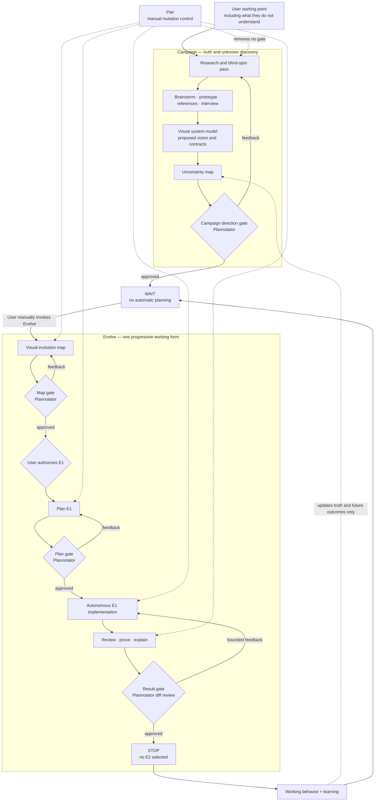

# Praxis Control Flow

Praxis has two operating paths:

- **Direct work:** route the user's immediate question directly to the owning engineering activity. Do not create Campaign or Evolve ceremony.
- **Initiative work:** when Campaign and manually invoked Evolve govern an unknown-heavy initiative, follow this state machine exactly.

## Resolve The State

Before acting, state:

- **Context:** governing Campaign, map, and current plan.
- **State:** discovering, waiting, mapping, planning, executing, or result review.
- **Authority:** none, one named evolution authorized, or Pair-controlled.
- **Next gate:** Campaign, map, plan, result, or none.
- **Forbidden next:** the tempting transition that has not been authorized.

Durable state may record explicit authority for resumption; missing authority means stop. Current source, evidence, repository policy, and the user's latest instruction outrank saved prose.

## Gates And Authority

A gate judges an artifact or diff. If Plannotator exists, file gates run `plannotator annotate <file> --gate --json` and result gates run `plannotator review`; otherwise require explicit inline approval. Approval advances, feedback revises and re-gates, and dismissal stops.

Authorization grants mutation authority through explicit user language. Map approval grants none. Authorizing E1 permits planning E1, but code remains blocked until its plan gate passes. Plan approval releases execution only inside authorized E1. Result approval closes E1. No gate grants E2, cleanup, commit, push, deployment, merge, or another external mutation unless its presented scope said so.

Pair overrides autonomous mutation authority wherever active. It preserves every gate.

## Information Altitude

| Surface | Owns | Rejects |
| --- | --- | --- |
| Campaign | vision, domain truth, system boundaries, observable contracts, uncertainty | task order, file lists, internal mechanisms |
| Evolution map | working outcomes, learning targets, limitations, proof | detailed designs and future plans |
| Current plan | volatile program decisions and executable work for one evolution | later evolutions and speculative machinery |
| Execution | exact code and local choices inside the plan | boundary or contract expansion |

Early work may inspect code, research mechanisms, or prototype deeply. Promote the truth learned, not the prototype's mechanics. If implementation could change while preserving a statement, the statement may belong above planning; otherwise it is probably an implementation detail.

Plan feedback changes only the plan. Result feedback may correct only accepted evolution scope. A discovery that changes vision, contract, compatibility, or evolution boundary stops and returns to the relevant earlier gate. After result approval, update learning and wait for another manual Evolve invocation.
